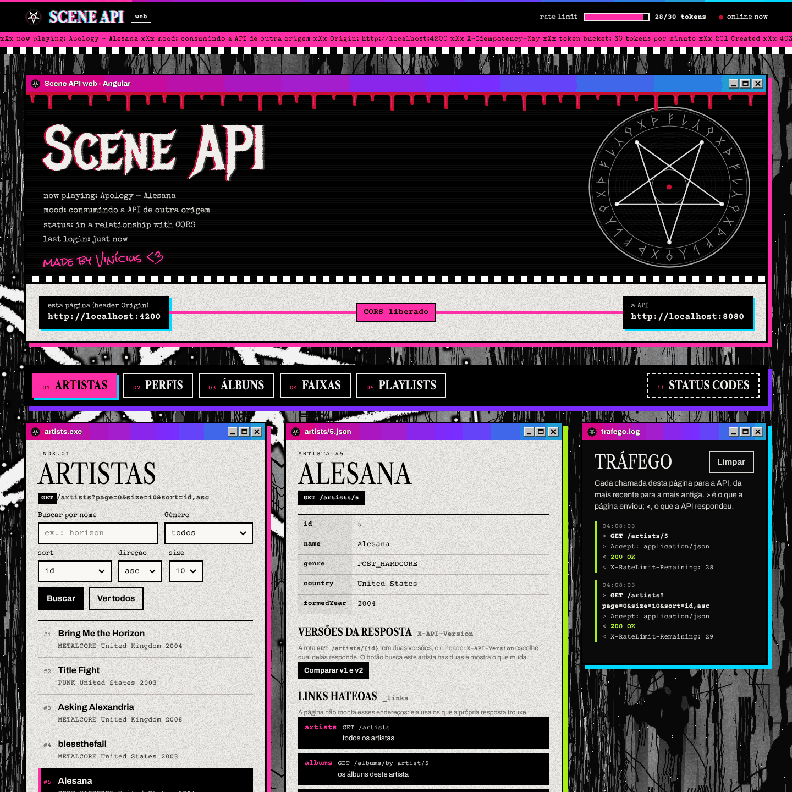

# Scene Web

Front-end em **Angular 21** que consome a [Scene API](https://github.com/Vikai23/scene-api) (Spring Boot). Ele lista, busca, cria, edita e exclui artistas, perfis, álbuns, faixas e playlists. Também navega pelos links HATEOAS de cada resposta, compara as duas versões da API lado a lado e tem uma aba **Status codes** que provoca cada status de erro da API.

> Projeto final de Web Services (Senac TSI), Parte 2. A API e este front ficam em repositórios separados: são duas origens diferentes, e o CORS é a ponte entre elas.



## Como executar

Requisitos: **Node.js 20.19+, 22.12+ ou 24** e a Scene API rodando em `http://localhost:8080`.

```bash
npm install
npm start
```

Abra `http://localhost:4200`. Essa é a origem liberada no CORS da API (`scene.cors.allowed-origins`).

O endereço da API fica em [`src/app/core/api.config.ts`](src/app/core/api.config.ts).

### Ver o CORS bloqueando

```bash
npm run start:bloqueado
```

Esse comando sobe o mesmo front na porta 4300, que não está na lista da API. Abra `http://localhost:4300`: a página avisa "Bloqueado pelo CORS", e o Console do navegador (F12) mostra a mensagem `blocked by CORS policy`.

## Telas

| Rota | O que faz |
| :-- | :-- |
| `/artists`, `/artist-profiles`, `/albums`, `/tracks` e `/playlists` | Lista paginada com busca, filtro (gênero, formato ou visibilidade), `sort` e `size`. Os detalhes mostram os campos, os links HATEOAS e as ações `PUT` e `DELETE`. Também tem cadastro e edição |
| `/status-codes` | Status codes: 16 botões que provocam de propósito cada erro da API (`400`, `403` do CORS, `404`, `405`, `406`, `409`, `415`, `422` e `429`) |

O que dá para fazer nas telas:

- **Links HATEOAS:** cada link do item abre o recurso ou a lista para onde aponta (os álbuns de um artista, o álbum de uma faixa...). Os botões de página seguem `_links.first`, `prev`, `next` e `last`.
- **Relacionamentos:**
  - colocar e tirar faixas de uma playlist (N:N);
  - cadastrar um álbum a partir do artista e uma faixa a partir do álbum (1:N);
  - criar o perfil quando o link `profile` devolve `404` (1:1).
- **Validação na API:** os formulários mandam o JSON sem conferir nada. Quem valida é a API, e o `400` aponta o erro embaixo de cada campo.

## Como o front usa os recursos da Parte 2

- **CORS:** o front (`:4200`) e a API (`:8080`) são origens diferentes. O topo da página mostra as duas e se o CORS liberou a ligação entre elas.
- **Idempotência:** todo `POST` leva um `X-Idempotency-Key`, um UUID gerado no navegador. Depois do `201`, o botão *Repetir o mesmo POST com a mesma key* faz a API devolver a resposta original com `X-Idempotent-Replayed: true`, sem criar nada.
- **Rate limiting:** o topo mostra os tokens que restam no bucket (`X-RateLimit-Limit` e `X-RateLimit-Remaining`). Depois de um `429`, ele mostra a contagem regressiva do `Retry-After`.
- **Versionamento:** o front usa a versão padrão (1). Nos detalhes de um artista, o botão *Comparar v1 e v2* busca o mesmo artista com `X-API-Version: 1` e `2`, mostra numa tabela o que muda de uma versão para a outra e coloca os dois JSON lado a lado. A aba Status codes mostra o `400` de uma versão que não existe. No Swagger da API, o seletor *Versão da API* troca a documentação inteira.
- **Tráfego:** a janela ao lado registra cada chamada, com os headers enviados e recebidos e o status.

## Estrutura

```text
src/app
├── core/                    serviços e tipos compartilhados
│   ├── api.config.ts            URL da API e nomes dos headers
│   ├── api.interceptor.ts       roda em toda chamada: Accept, rate limit, CORS, Tráfego e erros
│   ├── scene-api.service.ts     todas as chamadas à API
│   ├── resources.ts             os 5 recursos: rotas, campos, sort, busca, filtro e links
│   ├── models.ts                tipos que espelham o JSON da API
│   ├── status.service.ts        estado do CORS e do rate limit (signals)
│   ├── traffic.service.ts       registro do Tráfego
│   └── navigation.service.ts    pedidos de uma aba para outra (seguir um link, abrir um cadastro já preenchido)
├── shared/                  caixa de resposta e janela de Tráfego
└── pages/
    ├── resources/               aba de cada recurso: lista, detalhes, formulário, faixas da playlist e versões do artista
    └── status-codes/            aba Status codes
```

O código usa componentes standalone, signals e o novo controle de fluxo (`@if` / `@for`), sem zone.js. O visual (`src/styles.css`) é o mesmo tema do Swagger da API. Fontes e imagens ficam em `public/`, e as licenças das fontes em `public/fonts/licenses`.

## Licença

Distribuído sob a licença Apache 2.0 — veja o arquivo [LICENSE](LICENSE).

## Autor

**Vinícius Alves e Sousa** — Senac TSI, projeto final da disciplina de Web Services.

[GitHub](https://github.com/Vikai23) · [LinkedIn](https://www.linkedin.com/in/vinicius-alves-e-sousa/)
